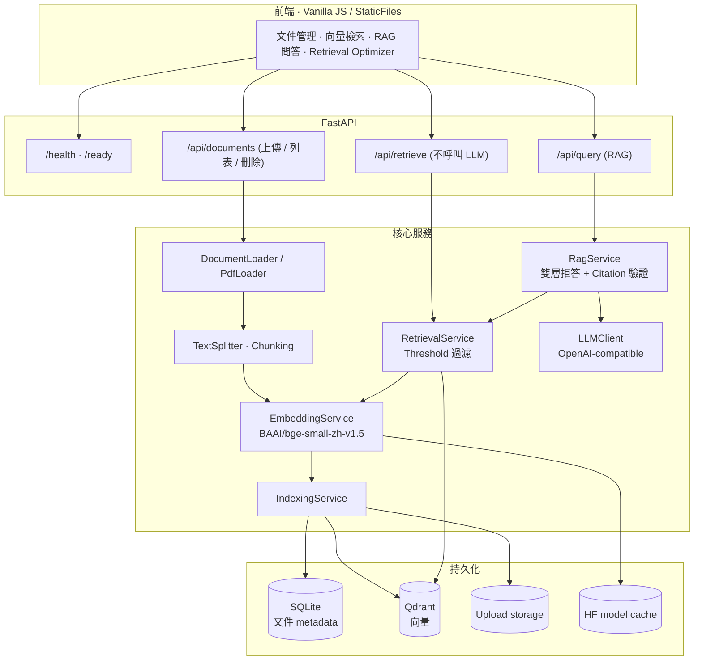
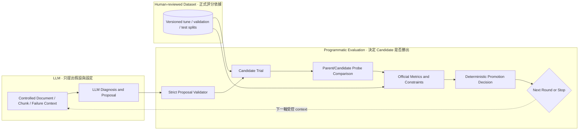
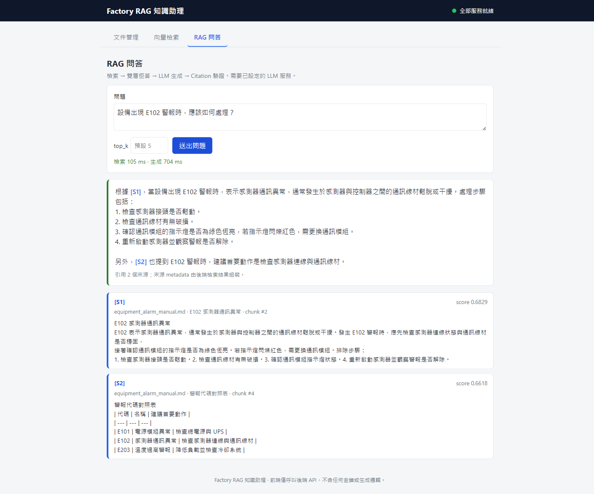
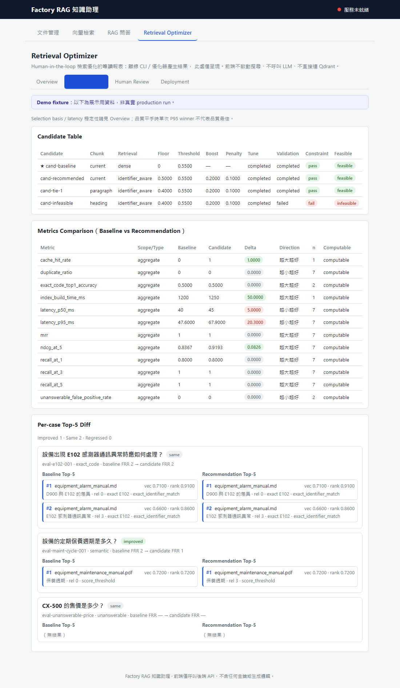
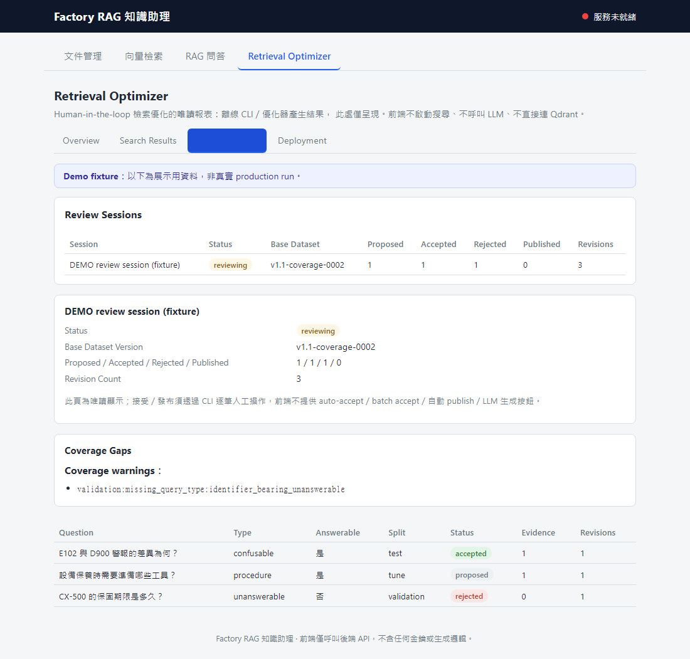
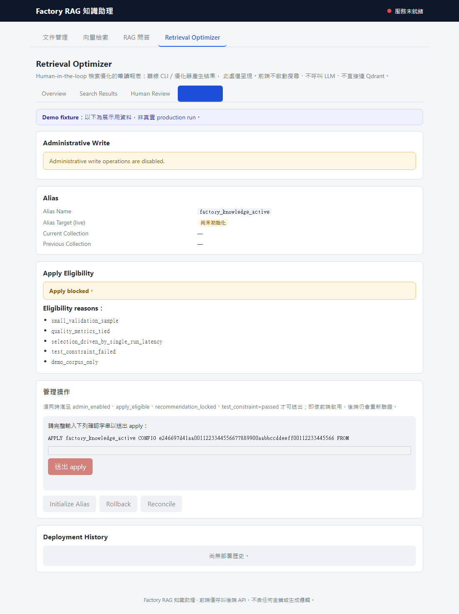

# Factory RAG 知識助理

可透過 **Docker Compose** 啟動的智慧製造文件 RAG 作品集專案：文件管理、向量檢索、LLM 問答、
來源引用（Citation）與雙層拒答，之上再疊一套**檢索評估與最佳化 Agent**。

支援 Markdown / TXT / PDF 上傳、本地中文 Embedding、Qdrant 向量檢索、Citation 驗證，
並提供純 Vanilla JS 的簡易前端。

### 與一般 RAG Demo 的差別

建立可靠 RAG 的隱性成本不只是 Vector DB 或 API，而是**人工閱讀文件、設計 Chunking、
建立評估問題、綁定 Evidence、執行測試與反覆診斷 Retrieval Failure**：

```text
閱讀大量文件 → 找出值得測試的知識點 → 設計可回答／不可回答／易混淆案例
  → 綁定正確的文件證據 → 執行檢索測試 → 依失敗案例再回頭補充資料
```

本專案把這條迴圈變成受控、可稽核的流程 —— 而且**LLM 只提出假設與設定，不決定自己的提案是否勝出**。
勝負一律由人工審核過的資料集、Metrics、Constraints 與 deterministic gate 判定；
**候選被拒絕是有效結果**。

> **LLM 狀態**：LLM 呼叫層（OpenAI-compatible Chat Completions）已完成，並已以外部 Provider
> 完成端到端驗證（見 [Runtime Verification](#runtime-verification)）。未設定 LLM 時，`/api/query`
> 會回傳 `503 LLM_NOT_CONFIGURED`，文件管理與向量檢索（`/api/retrieve`）仍可正常使用。

## 版本

| 版本 | Tag | 內容 |
| --- | --- | --- |
| v1.0 | `v1.0-rag-mvp` | RAG 核心：文件管理、向量檢索、LLM 問答、Citation 驗證與雙層拒答 |
| v1.1 | `v1.1-retrieval-optimizer` | [Human-in-the-loop Retrieval Optimizer](#v11--human-in-the-loop-retrieval-optimizer)：LLM 協助出題 + 人工審核 + 隔離檢索試驗 |
| v1.2 | `v1.2-llm-agent-mvp` | [LLM-guided Retrieval Optimization Agent](#v12--llm-guided-retrieval-optimization-agent)（**目前版本**）：有界 Agent 迴圈 + deterministic promotion gate |

三個版本皆為累加，v1.2 的 Agent 直接使用 v1.1 人工審核過的評估資料集作為正式評分依據。

---

## 核心架構



`LLM` 為 OpenAI-compatible 端點，**不綁定特定供應商**；未設定時 `/api/query` 回 `503 LLM_NOT_CONFIGURED`。

API：`/health`、`/ready`、`/api/documents`（POST / GET / DELETE）、`/api/retrieve`（**不呼叫 LLM**）、
`/api/query`。錯誤統一格式 `{"error": {"code", "message", "details"}}`。
完整 request／response、狀態碼與錯誤碼、資料流與 Prompt 規格見 [PROJECT_SPEC.md](PROJECT_SPEC.md) §14–§22。

---

## v1.2 — LLM-guided Retrieval Optimization Agent

**目前版本。** 有界（bounded）的 LLM-guided 檢索最佳化 Agent —— LLM 只提出假設與設定，
是否勝出一律交由固定資料集、Metrics、Constraints 與 deterministic gate 判定。



- **LLM**：閱讀受控的文件片段、Chunk 與失敗實況，提出診斷、Probe Questions 與下一輪
  Chunking／Retrieval 設定。它只提案，**不決定自己的提案是否勝出**。
- **Programmatic Evaluation**：Strict Validator → Candidate Trial → Parent／Candidate Probe
  比較 → Metrics／Constraints → deterministic promotion gate。
- **Human-reviewed Dataset**：tune／validation／test 分割皆來自 v1.1 人工審核過的評估資料集，
  是唯一的正式評分依據；LLM 只看得到 tune 逐題資料與 validation 的 coarse gate。
- **Promotion 語義**：`config_hash` 只是穩定排序的最後 tiebreak，**不是品質指標**；
  所有實質品質指標打平時判定為**不勝出**。

**Safety Boundaries（節錄）**：Bounded rounds／LLM calls、Strict JSON Proposal Schema
（parser／validator 獨立於 LLM）、Whitelist-only Config、不自動 Apply、不自動 Publish Dataset、
正式 collection `factory_knowledge` **永不被觸碰**、匿名化 Audit（不存 secret／完整 prompt／文件全文）。

> 完整設計（Proposal Schema、Validator 七項政策、白名單參數空間與界限、Budget、Promotion 判定、
> 11 條 Safety Boundaries）見 **[docs/v1.2-agent-design.md](docs/v1.2-agent-design.md)**。

---

## v1.1 — Human-in-the-loop Retrieval Optimizer

LLM 協助建立評估資料，再以隔離檢索試驗與人工審核形成閉環。由兩個相連的 Loop 組成：

```text
Loop A（Dataset Authoring）  受版控文件 → LLM 出題候選 → 人工審核 → Canonical Evidence
                              → 發布版本化 Dataset → Coverage／Failure Review
Loop B（Retrieval Optimization）版本化 Dataset → 隔離 Trial → 切分／檢索設定搜尋 → Metrics
                              → Hard Constraints → Pareto → Recommendation Lock → Test Split 驗收
```

Loop B 的 Failure／Coverage Report 成為 Loop A 下一輪的輸入，但**每一步都需人工明確啟動**——
系統提供形成閉環所需的元件與工作流程，不是在背景持續自動運行的 daemon。

安全機制：Admin API 預設停用（停用時 write endpoint 一律 403）、所有寫入需 typed confirmation、
套用前驗證 corpus／dataset／config／commit hash、alias 原子切換、append-only 稽核、報表唯讀。

> 完整內容：[架構與兩個 Loop](docs/v1.1-retrieval-optimizer-architecture.md) ·
> [需求與 metrics 定義](docs/v1.1-retrieval-optimizer-requirements.md) ·
> [Dataset Authoring CLI](docs/developer-guide.md#41-llm-assisted-dataset-authoring)

---

## Quick Start

### 1. Docker Compose（RAG 主系統）

```powershell
# 建立 .env（未設定 LLM 時檢索仍可用）
Copy-Item .env.example .env

# 建置並啟動 FastAPI + Qdrant
docker compose up --build -d
docker compose ps

# 開啟前端 → http://localhost:8000/
```

- `GET /health` → 200；`GET /ready` → 依賴就緒檢查。
- 未設定 LLM 時 `llm_config=error` 並回 503 屬**預期行為**，文件上傳、列表、刪除與
  `/api/retrieve` 皆可正常使用；`/api/query` 回 `503 LLM_NOT_CONFIGURED`。
- **不要**為了讓 `/ready` 回 200 而填入假的 LLM 設定。

第一次啟動會下載 Embedding 模型（需網路，之後由 volume cache）。更換 Embedding 模型後需**重新 indexing**。

### 2. 本地開發（venv）

需自行啟動 Qdrant（`docker run -p 6333:6333 qdrant/qdrant`），並讓 `.env` 的 `QDRANT_URL` 指向它：

```powershell
.venv/Scripts/python.exe -m uvicorn app.main:app --reload
```

### 3. v1.2 Agent Demo（**不需要 API key**）

以下指令在**不呼叫任何 Provider** 的情況下跑完 Fake Planner 迴圈（需可連線的 Qdrant）：

```powershell
# Fake Planner（不呼叫 LLM）
python -m evaluation.v12.agent.cli optimize `
  --config evaluation/configs/v12-agent-smoke.json `
  --planner fake `
  --max-rounds 2

# 檢視匿名化 Audit（Run ID 與 Agent DB 路徑由上一步的 Run Summary 印出）
python -m evaluation.v12.agent.cli show <agent_run_id> --agent-db <agent.db>
```

真實 LLM 路徑需要 `LLM_BASE_URL` / `LLM_API_KEY` / `LLM_MODEL`，且**一律需明確 `--planner llm`**
（不會因環境存在金鑰就自動呼叫）。API Key 只放本機 `.env`（已被 `.gitignore` 忽略）。

> 環境變數全表、optimizer CLI、Docker CLI profile、Optimizer UI 示範資料與前端說明見
> **[docs/developer-guide.md](docs/developer-guide.md)**。

---

## Runtime Verification

### v1.0 RAG（外部 OpenAI-compatible Provider）

```text
Verified provider: Groq OpenAI-compatible API
Verified model:    llama-3.3-70b-versatile

E102 警報處理     → HTTP 200、模型實際回答、Citation [S1][S2] 有效、Sources 對應正式文件
台灣首都           → Threshold 前置拒答、sources=[]、generation_ms=0、未呼叫 LLM
CX-500 市場售價    → 拒答且未猜測價格（本次由第一層 Threshold 擋下）

延遲（單次樣本，非穩定 benchmark）：Retrieval 98 ms / Generation 2047 ms / Total 2145 ms
```

檢索評估（v1.0 的 20 題題庫，raw threshold=0.0、top_k=10）：`Hit@1 = 1.0`、`Hit@3 = 1.0`、
`Section Hit@1 = 0.909`、`Page Hit@1 = 1.0`。v1.1 另有一組 15 案例 Baseline（加入 confusable 與
unanswerable 壓力測試，`Hit@1 = 0.7273`），兩者**題庫與難度不同，不可直接比較**。

→ [docs/v1.0-runtime-verification.md](docs/v1.0-runtime-verification.md) ·
[evaluation/results.json](evaluation/results.json) ·
[evaluation/baseline-v1.1.md](evaluation/baseline-v1.1.md)

### v1.2 Agent（匿名化驗收摘要）

```text
Fake Qdrant:  2 rounds · 2 candidate trials · Parent/Candidate probes executed
              Probe feedback entered the next round
              Candidates rejected by deterministic gate · No residual collections

Real LLM:     OpenAI-compatible · llama-3.3-70b-versatile
              1 valid proposal · score_threshold 0.55 → 0.50 · Candidate trial completed
              3 probes compared on parent and candidate
              Official metrics and constraints completed
              Candidate rejected by deterministic gate
              No Apply, Publish, Alias Switch or residual collection
```

Candidate rejection is a valid result. The LLM proposes experiments; it does not decide
whether its own proposal wins. 驗收摘要不含 API key、完整 prompt、文件全文或私人資料。

→ 完整紀錄（環境隔離、promotion 判定用語澄清、runtime bug 根因與修法、Safety Audit）見
[docs/v1.2-runtime-acceptance.md](docs/v1.2-runtime-acceptance.md)。

### 測試

```text
880 unit tests            # 804（v1.0 / v1.1）+ 76（v1.2 agent）— 最近一次實際重跑並全數通過
36 non-LLM integration    # 需可連線的 Qdrant；此為目前收集到的測試數
7  Playwright E2E         # 需已啟動的 API；此為目前收集到的測試數
```

另有 5 個 `llm_integration` 測試在非 LLM 驗證流程中被 deselect（未設定 LLM 環境變數時自動 skip）。
→ [docs/testing.md](docs/testing.md)

---

## 技術棧

| 層面 | 技術 |
| --- | --- |
| Web / API | FastAPI + Uvicorn |
| 前端 | HTML + CSS + Vanilla JavaScript（FastAPI StaticFiles，無 React/Vue） |
| Embedding | `BAAI/bge-small-zh-v1.5`（512 維，本地 sentence-transformers） |
| 向量資料庫 | Qdrant（Cosine） |
| 文件 metadata | SQLite |
| PDF 解析 | PyMuPDF |
| LLM 介面 | OpenAI Python SDK（OpenAI-compatible，可指向 OpenAI / Groq / vLLM / Ollama 等） |
| 容器化 | Docker Compose（FastAPI + Qdrant + 持久化 volumes） |

---

## 已完成能力

**RAG 核心（v1.0）** — PDF／Markdown／TXT 處理與 SHA-256 去重、SQLite 文件 Registry、
Chunking 與 Token hard limit、本地 Embedding、Qdrant Top-K 與 Threshold 過濾、
OpenAI-compatible LLM 問答、**Citation 驗證與無效 Citation fail-closed**、雙層拒答、
Docker Compose 與 Health／Readiness、Unit／Integration 測試與 Retrieval Evaluation。

**Retrieval Optimizer（v1.1）** — LLM-assisted candidate generation（一律以 `proposed` 狀態落庫）、
Canonical evidence 與版本化評估資料集（tune／validation／test + group leakage 檢查）、
隔離 trial 與 embedding cache、**deterministic grid／random search（不呼叫 LLM）**、
hard constraints 與 Pareto frontier、identifier-aware retrieval（dense ∪ identifier 聯集 +
exact-match boost／confusable penalty）、人工審核的資料集發布（遞增 revision，**不覆寫歷史**）、
帶防護的 apply／rollback 與 alias 切換、唯讀報表 API 與前端分頁、Docker CLI profile 與 Playwright E2E。

**LLM-guided Agent（v1.2）** — 有界 Agent 迴圈、受控 context 組裝（`editable_current_config`
只含白名單欄位）、Strict JSON Proposal Schema 與獨立 parser／validator、Fake Planner 與 LLM Planner、
隔離 Candidate Trial 與 Parent／Candidate Probe 比較、official metrics／constraints 與
deterministic promotion gate、匿名化 Audit 與 `show` CLI、安全的 collection 清理。

---

## 已知限制

**v1.0 RAG**

1. Production retrieval 目前是純向量 baseline（未加入 keyword / hybrid / reranker）。
   **離線 evaluation 層自 v1.2.1 起具備 Cross-Encoder reranking，但 production
   `/api/retrieve` 維持 dense-only，未使用 reranker**（見
   [v1.2.1 rerank design](docs/v1.2.1-rerank-design.md)）。
2. 語意相近但代碼不同的警報文件，可能干擾精確代碼查詢的排序。
3. 外部 Provider 已驗證正常回答與第一層 Threshold 拒答；**第二層語意拒答已由測試覆蓋，
   但本次 CX-500 查詢在第一層就被擋下，尚未以外部 Provider 實際走過該分支**。
4. 目前不處理會輸出 `<think>` 的 reasoning model；已驗證模型為 `llama-3.3-70b-versatile`。

**v1.1 Optimizer**

5. 評估資料集規模較小，validation 仍缺少 identifier-bearing unanswerable case。
6. 示範資料產生的推薦設定**尚未符合套用條件**，Deployment 頁面維持 `Apply blocked`：
   8 個可行候選在品質指標上完全相同，目前推薦實際上由單次 latency 差異決定；
   `eval-e102-001` 的 first relevant rank 在 baseline 與推薦設定中皆為 2。
7. P95 latency 受單機環境與執行順序影響，hard constraint 低於本機量測雜訊底限。
8. 尚未提供 RBAC、多人審核或背景工作佇列；未實作 BM25、sparse／hybrid 或完整 active sampling。
   （Cross-Encoder reranker 已於 v1.2.1 實作於**離線 evaluation 層**，未進 production。）
9. 管理介面定位為 single-machine local admin，**不建議直接暴露至公開網路**。

**v1.2 Agent**

10. Demo baseline 在示範資料上 Accuracy／MRR 已是 1.0，因此本迴圈證明的是「**迴圈與拒絕行為正確**」，
    而非可量測的品質改善。
11. 只能提出既有 whitelist 內的 chunking／retrieval 參數；Recommendation Eligibility 維持
    `not_evaluated`（held-out test 與 recommendation lock 不在 Emergency MVP 範圍）。
12. 目前只有最小 Audit（完整 resume 與報表 UI 為 deferred）；單一 provider／model 的一次執行
    不足以證明跨模型穩健性；token usage 可能為 null。

**v1.2.1 Cross-Encoder Rerank（離線評估層）**

13. 僅存在於離線 evaluation／optimizer 層；**production `/api/retrieve` 未使用 reranker，
    維持 dense-only**。
14. 品質改善**尚未正式成立**：tune／validation split 已飽和（各 arm 的 MRR／recall@1
    皆為 1.0，無鑑別力），而顯示出改善的 test split 已於 R0.5 被檢視，不再是 blind holdout。
    結論為「訊號有前景，但未經證實」。
15. 在既有 86 ms SLO 下不具 production latency 可行性：實測 `p95_retrieval_latency_ms`
    為 866.47 ms（`dense+CE`，n=30、cache 停用、local native-Qdrant loopback），約 10.08×。
    Loopback RTT 比遠端部署便宜，可能低估遠端延遲。
16. 未評估任何最佳化路徑（ONNX／OpenVINO／量化／換模型／GPU）。

**共通**：所有結果僅適用於受版控的示範語料，不代表已找到全域最佳參數，也尚未經過生產環境驗證。
範例文件皆為作品集示範所建立的**虛構資料**，不代表任何真實公司或設備。

---

## Demo

**v1.0 RAG**

<p>
  
  
</p>
<p>
  
  
</p>

**v1.1 Retrieval Optimizer**

<p align="center">
  
  
</p>
<p align="center">
  
  
</p>

> Optimizer 截圖皆使用示範資料（畫面標示 Demo），不含私人路徑、API key 或文件全文，
> 也不表示任何 apply 已成功。

---

## Documentation

| 文件 | 內容 |
| --- | --- |
| [docs/v1.2-agent-design.md](docs/v1.2-agent-design.md) | **v1.2 設計**：Agent Loop、states／stop reasons、受控 context、Proposal Schema、Validator 七項政策、白名單參數空間與界限、Budget、**Promotion 語義**、11 條 Safety Boundaries |
| [docs/v1.2-runtime-acceptance.md](docs/v1.2-runtime-acceptance.md) | **v1.2 驗收**：環境隔離、Fake 兩輪與 Real LLM 單輪逐項紀錄、promotion 判定用語澄清、runtime bug 根因與修法、Safety Audit |
| [docs/v1.0-runtime-verification.md](docs/v1.0-runtime-verification.md) | **v1.0 驗收**：真實 Provider 的 RAG 回答、兩種拒答路徑、Citation 驗證與延遲樣本 |
| [docs/v1.1-retrieval-optimizer-architecture.md](docs/v1.1-retrieval-optimizer-architecture.md) | **v1.1 架構**：Module 邊界、兩個 Loop、index／query／eval 資料流、Trial isolation、Qdrant payload 與 SQLite DDL、Apply／Rollback 與 alias migration、設計取捨表 |
| [docs/v1.1-retrieval-optimizer-requirements.md](docs/v1.1-retrieval-optimizer-requirements.md) | **v1.1 需求**：FR／NFR、eval case schema、Canonical Document 規則、metrics 定義與「合理 Top-5」選擇法、Safety Rules、Acceptance Criteria A–E |
| [docs/v1.1-retrieval-optimizer-plan.md](docs/v1.1-retrieval-optimizer-plan.md) | v1.1 開發計畫 Slice 0–8：scope／測試／驗收／風險與全域禁止事項（historical） |
| [docs/developer-guide.md](docs/developer-guide.md) | **實作者指南**：環境變數全表、專案結構、前端、v1.1 optimizer CLI 與 Dataset Authoring、v1.2 agent CLI、Docker CLI profile、Optimizer UI 示範資料 |
| [docs/api-reference.md](docs/api-reference.md) | **API Reference**：目前 main branch 的 HTTP API——23 個 registered endpoint、request／response schema、錯誤碼、Production 與 Evaluation 檢索差異 |
| [docs/testing.md](docs/testing.md) | **測試**：測試規模與誠實度說明、pytest markers、各層級執行方式與外部依賴 |
| [PROJECT_SPEC.md](PROJECT_SPEC.md) | **v1.0 歷史規格／設計參考**：資料模型、解析／Chunking 規則、匯入與 RAG 流程、Prompt 規格、測試策略——這些部分仍具參考價值；其 §19 API 章節記錄的是 v1.0 當時狀態，**目前 HTTP API 以 [docs/api-reference.md](docs/api-reference.md) 為準** |
| [evaluation/baseline-v1.1.md](evaluation/baseline-v1.1.md) | v1.1 Slice 0 Baseline：15 案例逐題 Top-5、E102／D900 排名壓力測試、硬限制門檻推導與可信度標註 |
