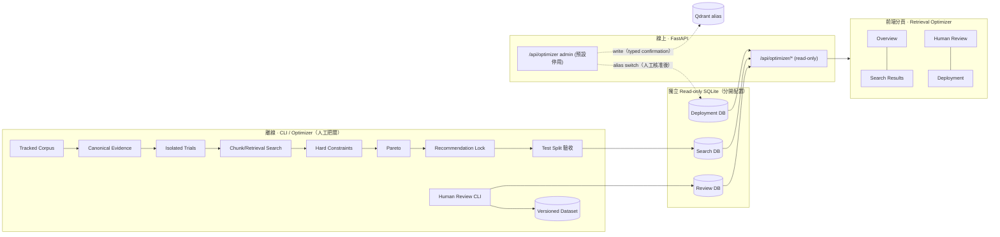
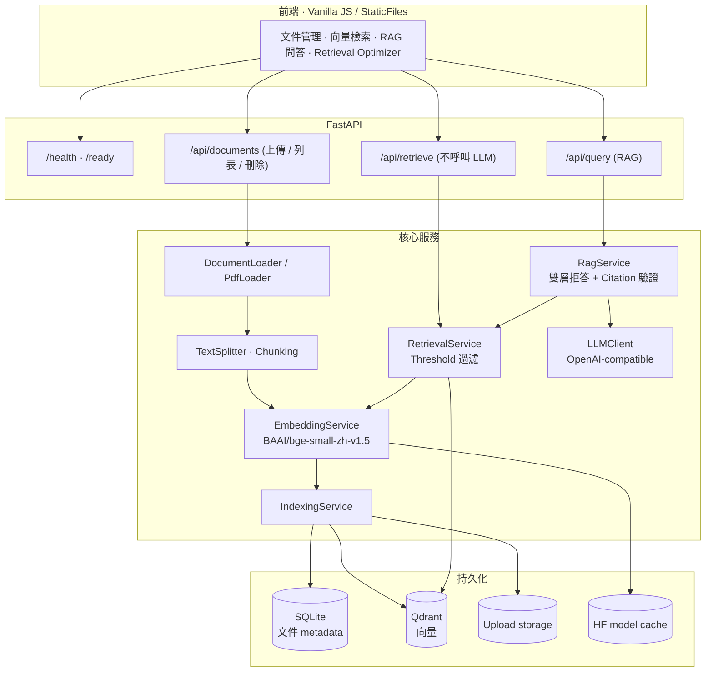
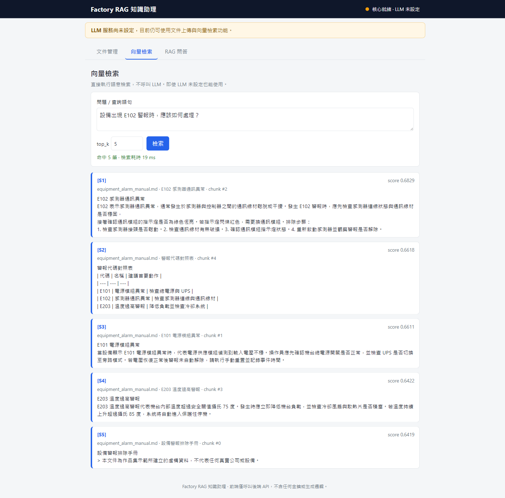

# Factory RAG 知識助理

可透過 **Docker Compose** 啟動的智慧製造文件 RAG 作品集 MVP，支援文件管理、向量檢索、
LLM 問答、來源引用（Citation）與拒答機制。

支援 Markdown / TXT / PDF 文件上傳、本地中文 Embedding、Qdrant 向量檢索、雙層拒答與
Citation 驗證，並提供一個純 Vanilla JS 的簡易前端。

> **LLM 狀態**：LLM 呼叫層（OpenAI-compatible Chat Completions）已完成，並已以外部 Provider
> 完成一次端到端驗證（見 [端到端驗證結果](#端到端驗證結果)）。未設定 LLM 時，`/api/query` 會
> 回傳 `503 LLM_NOT_CONFIGURED`，文件管理與向量檢索（`/api/retrieve`）仍可正常使用。

---

## v1.1 — Human-in-the-loop Retrieval Optimizer

v1.1 在原有的 RAG 文件問答之上，新增一套離線的檢索評估與調校流程。系統可比較不同的
文件切分（chunking）與檢索（retrieval）設定，透過硬性限制條件與 Pareto frontier 產生
候選設定（candidate），並提供人工審核、版本化評估資料集、報表介面，以及帶防護的
套用（apply）與回滾（rollback）機制。

搜尋在離線、隔離的 trial 中進行，產生的是候選設定而非直接生效的變更；套用功能預設停用，
需人工確認後才會動作。評估資料集與其證據可版本化，報表 UI 主要用於檢視結果。系統不包含
自主決策或自動部署機制。

### 主要功能

- **Canonical Evidence（標準證據）**：將評估答案連結到原始文件中版本化的證據範圍與 anchor。
- **Versioned Evaluation Dataset（評估資料集）**：以 tune、validation、test 分割資料，並檢查 group leakage。
- **Isolated Trials（隔離試驗）**：每組文件切分與檢索設定使用獨立的 evaluation run 與 Qdrant collection。
- **Retrieval Search（檢索搜尋）**：支援 deterministic grid search 與 random search。
- **Hard Constraints and Pareto Frontier**：先排除不符合條件的候選設定，再從非支配解中選出推薦項目。
- **Identifier-aware Retrieval**：聯集 dense 與 identifier-filtered 結果，並套用 exact-match boost 與 confusable penalty。
- **Embedding Cache**：以內容雜湊持久化快取，相同 chunk 文字可跨 trial 重用向量。
- **Human Review（人工審核）**：候選問題需經人工接受、編輯與證據確認後，才能發布為新版資料集；編輯一律產生新的 revision。
- **Safe Apply and Rollback（套用與回滾）**：透過 corpus／dataset hash、typed confirmation、idempotency 與 Qdrant alias 控制套用與回滾。
- **Reporting UI（報表介面）**：提供 Overview、Search、Review、Deployment 等唯讀報表。

### 工作流程

```
受版控示範語料
  → Canonical Evidence
  → 隔離 Trial
  → 文件切分／檢索參數搜尋
  → Hard Constraints
  → Pareto Frontier
  → Recommendation Lock
  → held-out test split 驗收
  → 人工審核
  → 安全套用／回滾
```

搜尋階段會列舉候選設定並在隔離 trial 中評估；硬性限制條件先排除不可行的設定，Pareto
frontier 再從其餘候選中選出推薦項目並鎖定。推薦設定需通過 held-out test split 驗收，評估
資料集的擴充則走人工審核流程。套用與回滾為受控操作，預設停用。

### 架構



### 目前評估結果

目前示範資料產生的推薦設定尚未符合套用條件，因此 Deployment 頁面會維持 `Apply blocked`。

目前觀察到的限制包括：

- 評估語料與 validation 樣本數仍少。
- 多個候選設定在檢索品質指標上得到相同結果（8 個可行候選在品質指標上完全相同）。
- 單次 P95 latency 容易受本機執行環境影響，不適合作為唯一的選擇依據；目前推薦實際上由單次 latency 差異決定。
- `eval-e102-001` 的 first relevant rank 在 baseline 與推薦設定中皆為 2；同一 chunk 同時包含 E102 與 D900 的歧義尚未解決。

目前結果僅適用於受版控的示範語料，不代表已找到全域最佳參數，也尚未經過生產環境驗證。

### 使用方式

以下指令可在不提供 API key 的情況下執行 optimizer 核心流程。

```bash
# Slice 0 baseline（v1.0 檢索 baseline；會覆寫 evaluation/results.json，請自行 git checkout 還原）
python -m evaluation.evaluate_retrieval

# Trial Runner / Chunking / Identifier smoke（隔離 collection，需 Qdrant）
python -m evaluation.v11.cli run --config evaluation/configs/slice2-smoke.json
python -m evaluation.v11.cli run --config evaluation/configs/slice3-chunking-smoke.json
python -m evaluation.v11.cli run --config evaluation/configs/slice4-identifier-smoke.json

# 檢索搜尋（grid／random search + constraints + Pareto + recommendation）
python -m evaluation.v11.search.cli --config evaluation/configs/slice5-optimizer-smoke-v2.json

# Human Review CLI：建立與審核新版評估資料集
python -m evaluation.v11.review.cli --help

# 建立 UI 示範資料；不建立 Qdrant collection，也不呼叫 LLM
python -m scripts.seed_optimizer_ui_demo --output-dir evaluation/demo

# 測試
python -m pytest tests/unit -q                                   # 全部 unit
python -m pytest tests/integration -q -m "not llm_integration"   # 非 LLM 整合（需 Qdrant）
```

Deployment Admin 預設停用；停用時所有 write endpoint 一律回 403，不會建構或呼叫 service。
啟用需明確設定 `OPTIMIZER_ADMIN_ENABLED=true`，且候選設定須符合套用條件。

前端 E2E（可重現流程；`npm ci` 由 `package-lock.json` 鎖版）：

```powershell
npm ci
npx playwright install chromium
npm run test:e2e
```

啟動 API 後，將 seeder 產生的三個路徑設給環境變數，即可在 UI 的 **Retrieval Optimizer** 分頁檢視示範資料：

```bash
OPTIMIZER_SEARCH_DB_PATH=evaluation/demo/optimizer-demo.search.db
OPTIMIZER_REVIEW_DB_PATH=evaluation/demo/optimizer-demo.review.db
OPTIMIZER_DEPLOYMENT_DB_PATH=evaluation/demo/optimizer-demo.deployment.db
```

Docker 使用者可用一次性 CLI profile（不新增常駐 worker，無 Redis／broker，不影響 `docker compose up`）：

```bash
docker compose --profile cli run --rm optimizer-cli \
  python -m scripts.seed_optimizer_ui_demo --output-dir storage/optimizer-demo
```

### 安全機制

- Admin API 預設停用（`OPTIMIZER_ADMIN_ENABLED=false`）；停用時 write endpoint 不建構、也不呼叫任何 service。
- 不自動套用、回滾或初始化 alias；所有寫入操作都需人工 typed confirmation。
- 套用前驗證 corpus、dataset、config 與 commit hash，與目前狀態不符即拒絕。
- Typed confirmation（例如 `APPLY <alias> CONFIG <hash> FROM <current>`），後端會重新驗證。
- Alias 採原子切換，不做 rename 或 delete。既有 `factory_knowledge` collection 被列為受保護資源，測試與部署流程使用獨立的 versioned collection。
- 每次操作寫入 append-only 稽核紀錄，idempotency key 防止重複執行。
- 報表為唯讀：UI 與 read API 以 SQLite `mode=ro` 開啟，不建立、不遷移、不修改資料，也不輸出私人路徑。
- 示範資料標示 `demo_fixture=true`，不會偽造 apply 成功，也不會建立實際 alias。

### 目前限制

- 評估資料集規模較小，validation 仍缺少 identifier-bearing unanswerable case。
- P95 latency 會受單機環境與執行順序影響，hard constraint 低於本機量測雜訊底限。
- 目前資料僅用於示範，不代表已通過生產環境驗證。
- 尚未提供 RBAC、多人審核或背景工作佇列（無 Redis／Celery）。
- 目前未實作 BM25、sparse／hybrid retrieval、reranker 或完整 active sampling。
- 管理介面定位為 single-machine local admin，不建議直接暴露至公開網路。

### 畫面展示（示範資料）

<p align="center">
  
  
</p>
<p align="center">
  
  
</p>

> 截圖皆使用示範資料（畫面標示 Demo），不含私人路徑、API key 或文件全文，也不表示任何 apply 已成功。

---

## 架構



`LLM` 為 OpenAI-compatible 端點，**不綁定特定供應商**；未設定時 `/api/query` 回 `503 LLM_NOT_CONFIGURED`。

### 上傳與檢索資料流

```
上傳 Markdown / TXT / PDF
  → SQLite 文件 Registry
  → DocumentLoader / PdfLoader 解析
  → TextSplitter 切 Chunk
  → EmbeddingService 產生向量
  → Qdrant 索引
  → Retrieval（Top-K + Threshold 過濾）
  → [RagService：雙層拒答 → LLM → Citation 驗證 → 組裝 Sources]
  → Response
```

---

## 技術棧

| 層面 | 技術 |
| --- | --- |
| Web / API | FastAPI + Uvicorn |
| 前端 | HTML + CSS + Vanilla JavaScript（FastAPI StaticFiles，無 React/Vue） |
| Embedding | `BAAI/bge-small-zh-v1.5`（512 維，本地 sentence-transformers） |
| 向量資料庫 | Qdrant（Cosine） |
| 文件 metadata | SQLite |
| PDF 解析 | PyMuPDF |
| LLM 介面 | OpenAI Python SDK（OpenAI-compatible，可指向 OpenAI / Groq / vLLM / Ollama 等） |
| 容器化 | Docker Compose（FastAPI + Qdrant + 持久化 volumes） |

---

## 快速開始

### 方式一：Docker Compose（建議）

```powershell
# 1. 建立 .env（可先複製範本；未設定 LLM 時檢索仍可用）
Copy-Item .env.example .env

# 2.（可選）驗證 compose 檔語法，且**不**輸出展開後的設定
docker compose config --quiet

# 3. 建置並啟動 FastAPI + Qdrant
docker compose up --build -d
docker compose ps

# 4. 開啟前端
#   http://localhost:8000/
```

> **安全**：`docker compose config` 可能輸出由 `.env` 展開後的內容。驗證 Compose 設定時
> 建議使用 `docker compose config --quiet`（只回傳 exit code），並避免公開貼出完整輸出。

- `GET /health` → 200
- `GET /ready` → 依賴就緒檢查（設定 LLM 後 `llm_config=ok`；未設定時 `llm_config=error` 並回 503，屬**預期行為**）。
- 文件上傳、列表、刪除、`/api/retrieve` 皆可正常使用。
- `/api/query` 在未設定 LLM 時回 `503 LLM_NOT_CONFIGURED`。

> **不要**為了讓 `/ready` 回 200 而填入假的 LLM 設定。

### 方式二：本地開發（venv）

需自行啟動一個 Qdrant（例如 `docker run -p 6333:6333 qdrant/qdrant`），並將
`.env` 的 `QDRANT_URL` 指向它（本地通常為 `http://localhost:6333`）。

```powershell
.venv/Scripts/python.exe -m uvicorn app.main:app --reload
```

---

## 環境變數

以 `.env`（不進版控）設定，範本見 [.env.example](.env.example)。重點：

| 變數 | 說明 |
| --- | --- |
| `QDRANT_URL` | Qdrant 位址。Compose 內用 service name：`http://qdrant:6333` |
| `QDRANT_COLLECTION` | 正式 Collection，預設 `factory_knowledge` |
| `EMBEDDING_MODEL` | 預設 `BAAI/bge-small-zh-v1.5` |
| `RETRIEVAL_SCORE_THRESHOLD` | 拒答門檻，預設 `0.55`（依現有資料集校準） |
| `LLM_BASE_URL` / `LLM_API_KEY` / `LLM_MODEL` | OpenAI-compatible 端點；**未設定時 `/api/query` 回 503** |

> **安全**：正式 API Key 只放本機 `.env`（已被 `.gitignore` 忽略），
> 不得寫入 `.env.example`、程式碼、前端或任何 log。

若 LLM 跑在 Docker 宿主機，Container 內應以 `host.docker.internal` 連回，
**不可**在 Container 內用 `localhost` 指向宿主機服務。

---

## API 一覽

| Method | Path | 說明 |
| --- | --- | --- |
| GET | `/health` | Process 存活檢查 |
| GET | `/ready` | 依賴就緒檢查（qdrant / collection / embedding / metadata_db / llm_config） |
| POST | `/api/documents` | 上傳並索引文件，成功回 201 |
| GET | `/api/documents` | 列出所有文件 |
| DELETE | `/api/documents/{id}` | 刪除文件與其全部向量，成功回 204 |
| POST | `/api/retrieve` | 純向量檢索（**不呼叫 LLM**） |
| POST | `/api/query` | RAG 問答（需 LLM；未設定回 `503 LLM_NOT_CONFIGURED`） |
| GET | `/` · `/static/*` | 簡易前端 |

錯誤統一格式：`{"error": {"code": "...", "message": "...", "details": {}}}`。

---

## 前端

純 HTML + CSS + Vanilla JS（[app/static/](app/static/)），四個分頁：

1. **文件管理** — 上傳、列表、刪除。
2. **向量檢索** — 呼叫 `/api/retrieve`，即使 LLM 未設定仍可展示。
3. **RAG 問答** — 呼叫 `/api/query`；收到 `503 LLM_NOT_CONFIGURED` 時顯示：
   > 「LLM 服務尚未設定，目前仍可使用文件上傳與向量檢索功能。」
4. **Retrieval Optimizer** — v1.1 的唯讀報表與受控管理操作介面，讀取 `/api/optimizer/*`；管理寫入操作預設停用。

前端不含任何金鑰、不偽造回答、不使用 Fake LLM 當作 Demo 回應；來源 metadata 一律由後端組裝。

---

## 已完成能力

**RAG 核心（v1.0）**

- PDF、Markdown、TXT 文件處理與 SHA-256 去重
- SQLite 文件 Registry
- Chunking 與 Token hard limit
- `BAAI/bge-small-zh-v1.5` 本地 Embedding
- Qdrant 向量搜尋、Top-K 與 Threshold 過濾
- OpenAI-compatible LLM Client 與 RAG 問答
- Citation 驗證與無效 Citation fail-closed
- Threshold 前置拒答與語意拒答流程
- FastAPI、靜態前端、Docker Compose、Health／Readiness
- Unit／Integration 測試與 Retrieval Evaluation

**Retrieval Optimizer（v1.1）**

- Canonical evidence 與版本化評估資料集
- 隔離的 chunking／retrieval trial 與 embedding cache
- Grid／random search、hard constraints 與 Pareto frontier 選擇
- Identifier-aware retrieval
- 人工審核的資料集發布流程
- 帶防護的 apply／rollback 與 Qdrant alias 切換
- 唯讀報表 API 與前端分頁
- Docker CLI profile 與 Playwright E2E 覆蓋

---

## 端到端驗證結果

以下為一次以外部 OpenAI-compatible Provider 完成的端到端驗證紀錄。Provider / Model 僅作為
已驗證環境的紀錄，並未寫死於應用程式架構中；系統可指向任一 OpenAI-compatible 端點。

```text
Verified provider: Groq OpenAI-compatible API
Verified model: llama-3.3-70b-versatile
```

RAG 驗證：

```text
E102（設備出現 E102 警報時，應該如何處理？）：
- HTTP 200
- 模型實際回答（非 fallback）
- Citation [S1] [S2] 有效
- Sources 皆對應 equipment_alarm_manual.md

台灣首都：
- Threshold 前置拒答
- Sources 為空
- generation_ms = 0
- 未呼叫 LLM

CX-500 市場售價：
- 拒答
- 沒有猜測價格
- 本次由第一層 Threshold 拒答
```

延遲（**單次實際樣本，非穩定 Benchmark**）：

```text
Retrieval：約 98 ms
Generation：約 2047 ms
Total：約 2145 ms
```

---

## Retrieval Evaluation

檢索評估（20 題題庫：12 可回答 / 8 不可回答，raw threshold=0.0，top_k=10）：

```text
Hit@1 = 1.0
Hit@3 = 1.0
Section Hit@1 = 0.909
Page Hit@1 = 1.0
```

完整結果與 threshold sweep 見 [evaluation/results.json](evaluation/results.json)。

---

## 測試結果

v1.1 發布前的驗證結果（實際重新執行）：

```text
804 unit tests passed
36 non-LLM integration tests passed
7 Playwright tests passed
```

其中 4 個 `llm_integration` 測試在非 LLM 驗證流程中被 deselect（未設定 LLM 環境變數時自動 skip）。

```powershell
# 單元測試（Fake LLM，不需外部服務）
.venv/Scripts/python.exe -m pytest tests/unit -q

# 非 LLM 整合測試（需 Qdrant）
.venv/Scripts/python.exe -m pytest tests/integration -q -m "not llm_integration"

# 前端 E2E
npm run test:e2e
```

另外對 `/api/query` 執行了一次最小 LLM smoke test（E102，見上方 [端到端驗證結果](#端到端驗證結果)），
回傳 HTTP 200、有效 Citation、Source 對應正式文件、無 `<think>` 內容。

---

## 已知限制

1. 目前是純向量 Retrieval baseline（尚未加入 keyword / hybrid / reranker）。
2. 語意相近但代碼不同的警報文件，可能干擾精確代碼查詢的排序。
3. Chunking 與 Retrieval 品質仍可在後續版本調校。
4. 外部 Provider 已驗證正常回答與第一層 Threshold 拒答。
5. 第二層語意拒答已由測試覆蓋，但本次 CX-500 查詢在第一層 Threshold 就被拒，
   因此尚未以外部 Provider 實際走過第二層語意拒答分支。
6. 目前不處理會輸出 `<think>` 的 reasoning model；已驗證模型為 `llama-3.3-70b-versatile`。

---

## Demo 圖片

<p>
  
  
</p>
<p>
  
  
</p>

---

## 專案結構

```
app/
  api/           health / documents / retrieve / query 路由 + optimizer 唯讀報表與 admin
  core/          config / constants / exceptions / logging
  services/      loader / splitter / embedding / indexing / retrieval / rag / llm_client / vector_store
  repositories/  document_repository（SQLite）
  schemas/       API 請求/回應模型
  prompts/       RAG prompt 組裝
  static/        Vanilla JS 前端（index.html / styles.css / app.js / optimizer.js）
  main.py        FastAPI app 與 lifespan
sample_docs/     範例文件（md / txt / pdf）
evaluation/      Retrieval 評估與 v1.1 optimizer（v11/：chunking / retrieval / search /
                 review / deploy / reporting）、datasets / configs / fixtures
scripts/         示範與驗證腳本（含 optimizer UI demo seeder、screenshot 擷取）
tests/           unit / integration / e2e（Playwright）
```
