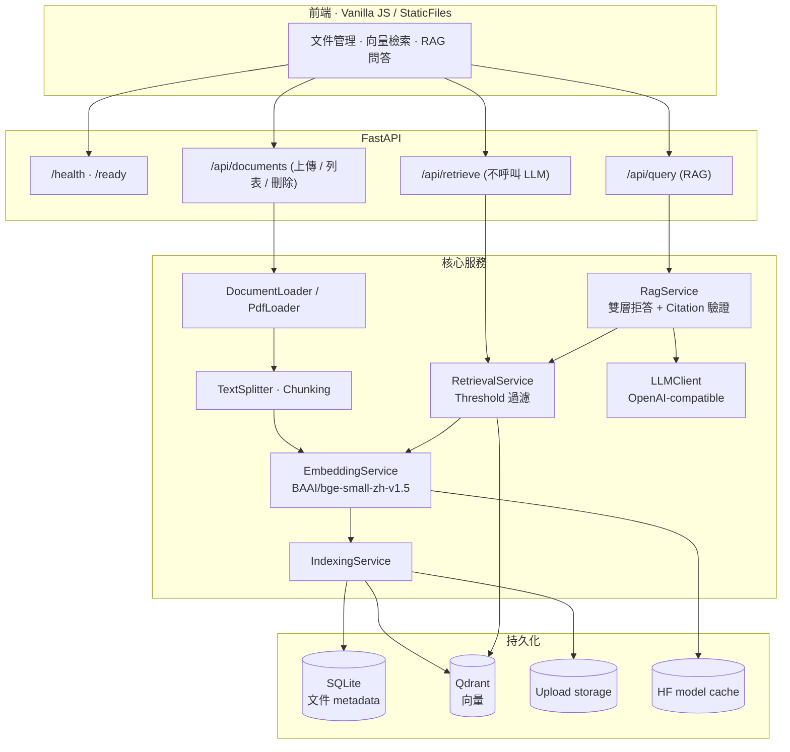
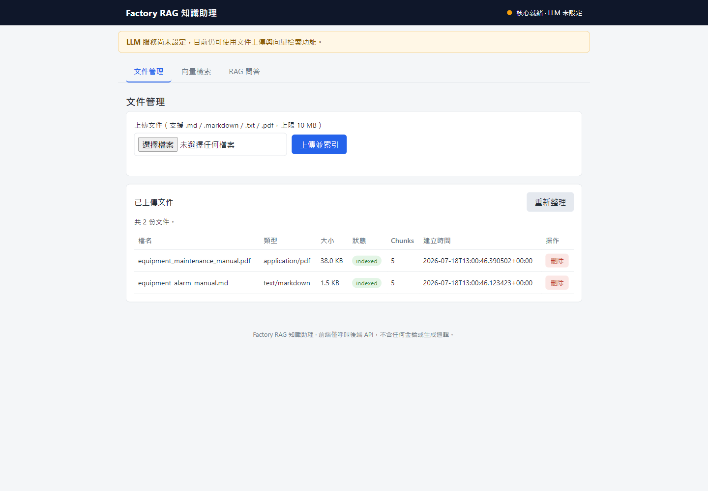

# Factory RAG 知識助理

可透過 **Docker Compose** 啟動的智慧製造文件 RAG 作品集 MVP，支援文件管理、向量檢索、
**真實 LLM 回答**、來源引用（Citation）及拒答機制。

支援 Markdown / TXT / PDF 文件上傳、本地中文 Embedding、Qdrant 向量檢索、雙層拒答與
Citation 驗證，並提供一個純 Vanilla JS 的簡易前端。

> **LLM 狀態**：LLM 呼叫層（OpenAI-compatible Chat Completions）已完成，並已以真實 Provider
> 完成一次端到端驗證（見 [真實驗證結果](#真實驗證結果)）。在未設定 LLM 時，`/api/query` 仍會
> 回傳明確的 `503 LLM_NOT_CONFIGURED`，而文件管理與向量檢索（`/api/retrieve`）完全可用。

---

## 架構



`LLM` 為 OpenAI-compatible 端點，**不綁定特定供應商**；未設定時 `/api/query` 回 `503 LLM_NOT_CONFIGURED`。

### 上傳與檢索資料流

```
上傳 Markdown / TXT / PDF
  → SQLite 文件 Registry
  → DocumentLoader / PdfLoader 解析
  → TextSplitter 切 Chunk
  → EmbeddingService 產生向量
  → Qdrant 索引
  → Retrieval（Top-K + Threshold 過濾）
  → [RagService：雙層拒答 → 真實 LLM → Citation 驗證 → 組裝 Sources]
  → Response
```

---

## 技術棧

| 層面 | 技術 |
| --- | --- |
| Web / API | FastAPI + Uvicorn |
| 前端 | HTML + CSS + Vanilla JavaScript（FastAPI StaticFiles，無 React/Vue） |
| Embedding | `BAAI/bge-small-zh-v1.5`（512 維，本地 sentence-transformers） |
| 向量資料庫 | Qdrant（Cosine） |
| 文件 metadata | SQLite |
| PDF 解析 | PyMuPDF |
| LLM 介面 | OpenAI Python SDK（OpenAI-compatible，可指向 OpenAI / Groq / vLLM / Ollama 等） |
| 容器化 | Docker Compose（FastAPI + Qdrant + 持久化 volumes） |

---

## 快速開始

### 方式一：Docker Compose（建議）

```powershell
# 1. 建立 .env（可先複製範本；未設定 LLM 時檢索仍可用）
Copy-Item .env.example .env

# 2. 建置並啟動 FastAPI + Qdrant
docker compose up --build -d
docker compose ps

# 3. 開啟前端
#   http://localhost:8000/
```

- `GET /health` → 200
- `GET /ready` → 依賴就緒檢查（設定 LLM 後 `llm_config=ok`；未設定時 `llm_config=error` 並回 503，屬**預期行為**）。
- 文件上傳、列表、刪除、`/api/retrieve` 皆可正常使用。
- `/api/query` 在未設定 LLM 時回 `503 LLM_NOT_CONFIGURED`。

> **不要**為了讓 `/ready` 回 200 而填入假的 LLM 設定。

### 方式二：本地開發（venv）

需自行啟動一個 Qdrant（例如 `docker run -p 6333:6333 qdrant/qdrant`），並將
`.env` 的 `QDRANT_URL` 指向它（本地通常為 `http://localhost:6333`）。

```powershell
.venv/Scripts/python.exe -m uvicorn app.main:app --reload
```

---

## 環境變數

以 `.env`（不進版控）設定，範本見 [.env.example](.env.example)。重點：

| 變數 | 說明 |
| --- | --- |
| `QDRANT_URL` | Qdrant 位址。Compose 內用 service name：`http://qdrant:6333` |
| `QDRANT_COLLECTION` | 正式 Collection，預設 `factory_knowledge` |
| `EMBEDDING_MODEL` | 預設 `BAAI/bge-small-zh-v1.5` |
| `RETRIEVAL_SCORE_THRESHOLD` | 拒答門檻，預設 `0.55`（依現有資料集校準） |
| `LLM_BASE_URL` / `LLM_API_KEY` / `LLM_MODEL` | OpenAI-compatible 端點；**未設定時 `/api/query` 回 503** |

> **安全**：真實 API Key 只放本機 `.env`（已被 `.gitignore` 忽略），
> 不得寫入 `.env.example`、程式碼、前端或任何 log。

若 LLM 跑在 Docker 宿主機，Container 內應以 `host.docker.internal` 連回，
**不可**在 Container 內用 `localhost` 指向宿主機服務。

---

## API 一覽

| Method | Path | 說明 |
| --- | --- | --- |
| GET | `/health` | Process 存活檢查 |
| GET | `/ready` | 依賴就緒檢查（qdrant / collection / embedding / metadata_db / llm_config） |
| POST | `/api/documents` | 上傳並索引文件，成功回 201 |
| GET | `/api/documents` | 列出所有文件 |
| DELETE | `/api/documents/{id}` | 刪除文件與其全部向量，成功回 204 |
| POST | `/api/retrieve` | 純向量檢索（**不呼叫 LLM**） |
| POST | `/api/query` | RAG 問答（需 LLM；未設定回 `503 LLM_NOT_CONFIGURED`） |
| GET | `/` · `/static/*` | 簡易前端 |

錯誤統一格式：`{"error": {"code": "...", "message": "...", "details": {}}}`。

---

## 前端

純 HTML + CSS + Vanilla JS（[app/static/](app/static/)），三個分頁：

1. **文件管理** — 上傳、列表、刪除。
2. **向量檢索** — 呼叫 `/api/retrieve`，即使 LLM 未設定仍可展示。
3. **RAG 問答** — 呼叫 `/api/query`；收到 `503 LLM_NOT_CONFIGURED` 時顯示：
   > 「LLM 服務尚未設定，目前仍可使用文件上傳與向量檢索功能。」

前端不含任何金鑰、不偽造回答、不使用 Fake LLM 當作 Demo 回應；來源 metadata 一律由後端組裝。

---

## 已完成能力

- PDF、Markdown、TXT 文件處理
- 文件 SHA-256 去重
- SQLite 文件 Registry
- Chunking 與 Token hard limit
- `BAAI/bge-small-zh-v1.5` 本地 Embedding
- Qdrant 向量搜尋
- Top-K 與 Threshold 過濾
- OpenAI-compatible LLM Client
- 真實 LLM RAG 回答
- Citation 驗證
- 無效 Citation fail-closed
- Threshold 前置拒答
- 語意拒答流程
- FastAPI
- 靜態前端
- Docker Compose
- Health／Readiness
- Unit／Integration Tests
- Retrieval Evaluation

---

## 真實驗證結果

以下為一次以真實 OpenAI-compatible Provider 完成的端到端驗證紀錄。Provider / Model 僅作為
**「已驗證環境」的紀錄**，並未寫死於應用程式架構中；系統可指向任一 OpenAI-compatible 端點。

```text
Verified provider: Groq OpenAI-compatible API
Verified model: llama-3.3-70b-versatile
```

真實 RAG 驗證：

```text
E102（設備出現 E102 警報時，應該如何處理？）：
- HTTP 200
- 真實模型回答（非 fallback）
- Citation [S1] [S2] 有效
- Sources 皆對應 equipment_alarm_manual.md

台灣首都：
- Threshold 前置拒答
- Sources 為空
- generation_ms = 0
- 未呼叫 LLM

CX-500 市場售價：
- 拒答
- 沒有猜測價格
- 本次由第一層 Threshold 拒答
```

延遲（**單次實際樣本，非穩定 Benchmark**）：

```text
Retrieval：約 98 ms
Generation：約 2047 ms
Total：約 2145 ms
```

---

## Retrieval Evaluation

檢索評估（20 題題庫：12 可回答 / 8 不可回答，raw threshold=0.0，top_k=10）：

```text
Hit@1 = 1.0
Hit@3 = 1.0
Section Hit@1 = 0.909
Page Hit@1 = 1.0
```

完整結果與 threshold sweep 見 [evaluation/results.json](evaluation/results.json)。

---

## 測試結果

以下為本次收尾實際重新執行的結果：

```powershell
# 單元 + 應用層（Fake LLM），不需外部服務
.venv/Scripts/python.exe -m pytest -m "not integration and not llm_integration"
# → 75 passed, 9 deselected

# 整合測試（需真實 Qdrant）
.venv/Scripts/python.exe -m pytest -m integration
# → 5 passed, 79 deselected

# 真實 LLM smoke test marker（未設定 LLM 環境變數時自動 skip）
.venv/Scripts/python.exe -m pytest -m llm_integration
```

另外對 `/api/query` 執行了一次最小真實 LLM smoke test（E102，見上方 [真實驗證結果](#真實驗證結果)），
回傳 HTTP 200、有效 Citation、Source 對應正式文件、無 `<think>` 內容。

---

## 已知限制

1. 目前是純向量 Retrieval baseline（尚未加入 keyword / hybrid / reranker）。
2. 語意相近但代碼不同的警報文件，可能干擾精確代碼查詢的排序。
3. Chunking 與 Retrieval 品質仍可在後續版本調校。
4. 真實 Provider 已驗證正常回答與第一層 Threshold 拒答。
5. 第二層語意拒答已由測試覆蓋，但本次真實 CX-500 查詢在第一層 Threshold 就被拒，
   因此尚未以真實 Provider 實際走過第二層語意拒答分支。
6. 目前不處理會輸出 `<think>` 的 reasoning model；已驗證模型為 `llama-3.3-70b-versatile`。

---

## Demo 圖片

<p>
  
  
</p>
<p>
  
  
</p>

---

## 專案結構

```
app/
  api/           health / documents / retrieve / query 路由
  core/          config / constants / exceptions / logging
  services/      loader / splitter / embedding / indexing / retrieval / rag / llm_client / vector_store
  repositories/  document_repository（SQLite）
  schemas/       API 請求/回應模型
  prompts/       RAG prompt 組裝
  static/        Vanilla JS 前端（index.html / styles.css / app.js）
  main.py        FastAPI app 與 lifespan
sample_docs/     範例文件（md / txt / pdf）
evaluation/      Retrieval 評估腳本與結果
tests/           unit / integration
```
