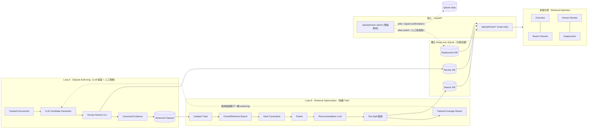
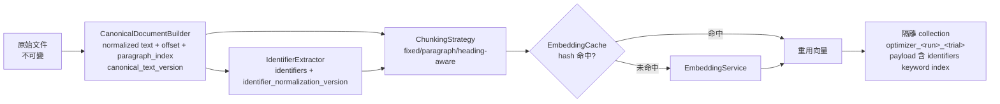
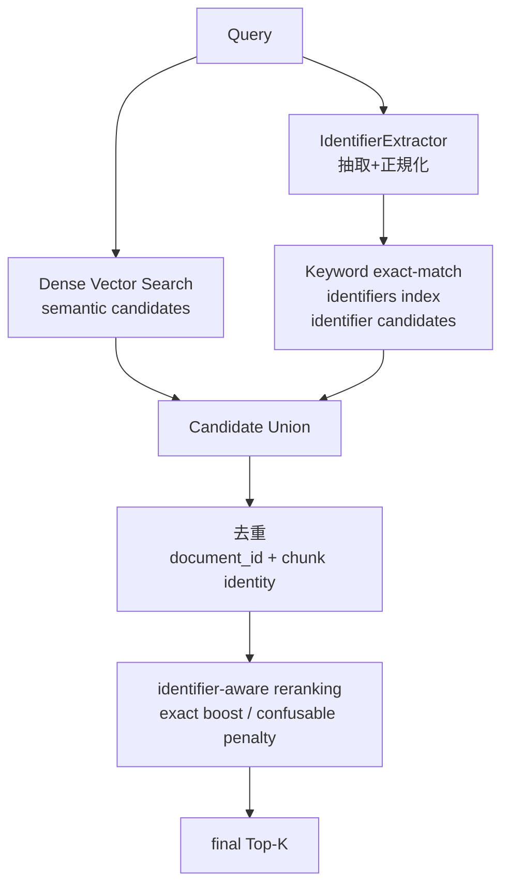
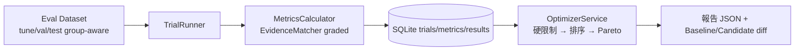
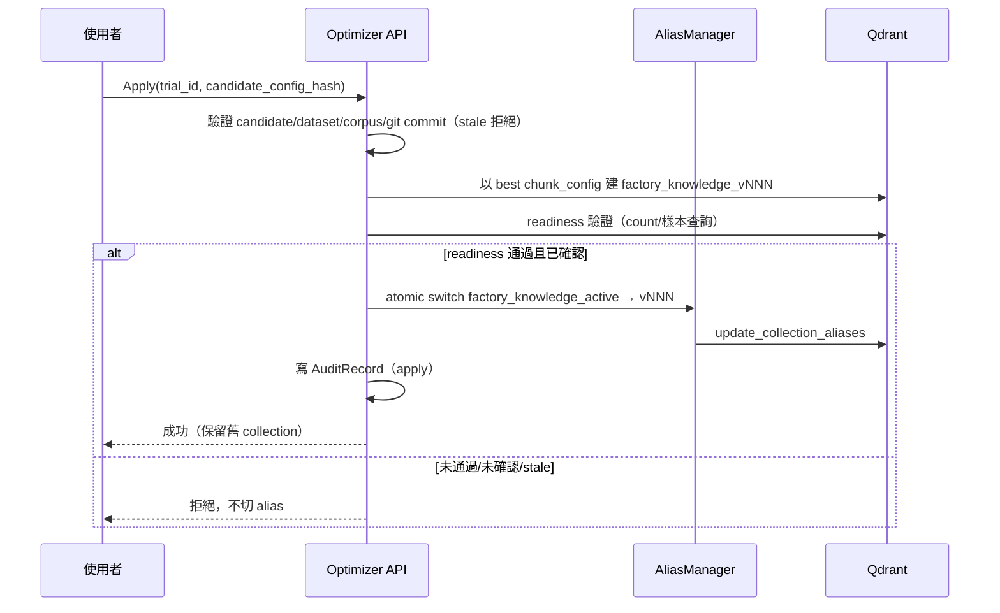

# v1.1 Retrieval Optimizer — Architecture

> 正式名稱：**Retrieval Optimizer**（完整：**Human-in-the-loop AutoRAG Retrieval Tuner**）
> 基線：`v1.0-rag-mvp`，commit `32a1dee`｜語言：繁體中文
> 狀態：**已於 v1.1 實作完成**（tag `v1.1-retrieval-optimizer`）。本文為當時核准的架構設計，
> 保留原始 Module / Table / API 草案與設計取捨供稽核。

與 [requirements](v1.1-retrieval-optimizer-requirements.md)、[plan](v1.1-retrieval-optimizer-plan.md) 一致。本文所有 Module / Table / API 皆在 plan 有對應落地 Slice。

---

## 1. 現有架構影響分析

v1.0 為單一 FastAPI 程序（`app.main:app`）+ vanilla JS 前端（`app/static/`）+ 獨立 Qdrant 容器；服務層在 `app/services/`，於 `app/dependencies.py::build_services()` 組裝並掛 `app.state`；所有 tunable 集中於 `app/core/config.py::Settings`。

### 1.1 可直接重用
| 元件 | 位置 | 重用方式 |
| --- | --- | --- |
| 迷你 optimizer 骨架 | `evaluation/evaluate_retrieval.py:88`（`build_services` / `ingest_samples` / `evaluate` / `threshold_report` / `_percentile` / `_summary`） | 抽成可 import 模組即為 `TrialRunner` 基礎；隔離 collection + threshold=0.0 收原始分數 + 記憶體掃描的模式保留 |
| Retrieval | `app/services/retrieval_service.py:37`（已參數化 `score_threshold`/`candidate_multiplier`/`candidate_cap`） | query-time 參數同索引可掃；作為 `RetrievalStrategy` 的 dense 基底 |
| Chunking | `app/services/text_splitter.py:40`（chunk 參數 + tokenizer 皆 DI） | 包成 `ChunkingStrategy` 的一個實作 |
| Embedding | `app/services/embedding_service.py:14`（load-once、tokenizer DI） | 外掛 content-hash cache |
| Vector store | `app/services/vector_store.py:13`（專屬 collection、cosine、payload index） | 加 `identifiers` keyword index + alias 操作 |
| Indexing | `app/services/indexing_service.py`（`index_document` 端到端） | Trial 建索引重用 |
| Config | `app/core/config.py:10`（可帶 override 實例化，eval script 已示範 `:90`） | 加 optimizer 參數與 canonical/identifier 版本 |
| SQLite repo | `app/repositories/document_repository.py:86`（短連線、`sqlite3.Row`、threadpool-safe） | 連線模式重用；新增 optimizer 表 |
| 測試 fakes | `tests/conftest.py`（`FakeEmbeddingService`/`FakeVectorStore`）、`tests/unit/test_rag_service.py`（`FakeRetrievalService`/`FakeLLMClient`） | Trial/metrics 快速單元測試，不下載模型、不打 LLM |
| 前端 | `app/static/`（分頁 SPA、`renderSourceCard` app.js:250） | 加第 4 tab、重用卡片渲染 |

### 1.2 必須抽象化 / 新增
- Ranking metrics（現僅二元 Hit@1/3 比檔名 `evaluate_retrieval.py:212`）→ `MetricsCalculator`。
- Eval case schema（現 `evaluation/questions.json` 綁 `expected_document/section/page`，無 anchor/offset）→ 擴充 + `EvidenceMatcher`。
- Provenance：`DocumentElement`（`app/models/document_element.py:11` 僅 text/page/section/element_type）與 `Chunk`（`app/models/chunk.py:8` 僅 page/section/chunk_index）**無 char offset、無 paragraph index、無 identifiers** → `CanonicalDocumentBuilder` + payload 新欄位。
- 無 embedding cache → `EmbeddingCache`。
- 無 hybrid/rerank seam（retrieval 純 dense）→ `RetrievalStrategy` + `IdentifierExtractor`。
- 無 migration 機制（raw `CREATE TABLE IF NOT EXISTS` `document_repository.py:19`）→ 輕量 migration + 新表。
- 無 collection alias（`qdrant_collection` 單一靜態）→ `AliasManager`。
- 無 async/worker 骨架 → v1.1 用 CLI job 規避。

### 1.3 會造成 migration 的項目
- **Qdrant payload**：新增 `char_start`/`char_end`/`paragraph_index`/`identifiers`/`canonical_text_version`/`identifier_normalization_version`。**非破壞**（舊 point 缺值為 null）；`identifiers` 建 keyword index。
- **Qdrant alias**：首次建立 `factory_knowledge_active` 指向現有 `factory_knowledge`（見 §8）。
- **SQLite**：新增 `eval_cases` / `eval_runs` / `trials` / `trial_metrics` / `trial_results` / `apply_audit`（見 §11）。

### 1.4 技術風險
1. 小樣本過擬合 → split + Pareto + 硬限制 + 樣本數揭露。
2. Canonical/offset 對位跨三層 → 版本化 + 非破壞 + anchor fallback。
3. Chunking trial 重算成本 → cache + index/query 參數分離。
4. Threshold 誘導誤命中 → 硬限制。

---

## 2. 推薦架構

```text
┌─────────────────────────────────────── 既有 v1.0（不改核心行為）───────────────────────────────────────┐
│ FastAPI(app.main)  ─ /api/query /api/retrieve /api/documents  ─ RagService/RetrievalService/... ─ Qdrant │
└────────────────────────────────────────────────────────────────────────────────────────────────────────┘
                          ▲ 只透過 alias 查詢（首次 migration 後）
┌─────────────────────────────────── v1.1 新增（optimizer 平面）───────────────────────────────────────────┐
│  CLI/離線 Job:  optimizer.run  ──► TrialRunner ──► (ChunkingStrategy → IndexingService+EmbeddingCache      │
│                                        │             → 隔離 collection → RetrievalStrategy)                 │
│                                        └─► MetricsCalculator(EvidenceMatcher) ──► SQLite + JSON 報告        │
│  FastAPI 管理 endpoint(/api/optimizer/*): 只讀報告 / cases CRUD / Apply / Rollback(AliasManager+AuditLog)  │
│  前端第 4 tab「Retrieval Optimizer」: 只讀報告 + 人工審核 + Apply/Rollback 觸發                             │
└──────────────────────────────────────────────────────────────────────────────────────────────────────────┘
```

**關鍵邊界**：Optimizer 長搜尋只在 CLI/離線 Job；FastAPI 只做「讀報告 / cases 管理 / Apply / Rollback」等短操作，不跑長搜尋，也**不阻塞** `/api/query`。

### 2.1 實作後的系統全貌

以下為 v1.1 實作完成後的實際分層（原由 README 承載，實作後併入本文件作為 canonical）：



### 2.2 兩個相連的 Loop

v1.1 由兩個互相銜接的流程組成：先建立評估資料，再用它最佳化檢索。

**Loop A — Evaluation Dataset Authoring**

```text
受版控文件／文件 Segment
  → LLM Candidate Generator（問題與證據候選）
  → 人工審核／編輯
  → Canonical Evidence
  → 發布版本化 Dataset
  → Coverage／Failure Review
  → 使用者依報告啟動下一輪 Candidate Generation
```

Coverage／Failure Report 指出下一輪值得補強的知識點，但系統**不會自動挑選下一個 Segment，
也不會自動開始下一輪**；下一輪生成由使用者根據報告明確啟動。

**Loop B — Retrieval Optimization**

```text
版本化 Dataset
  → 隔離 Trial
  → 文件切分／檢索設定搜尋
  → Metrics
  → Hard Constraints
  → Pareto Frontier
  → Recommendation Lock
  → held-out Test Split 驗收
  → Failure／Coverage Report
```

兩個 Loop 相連：Loop B 的 Failure／Coverage Report 會成為 Loop A 下一輪 Dataset Authoring
的輸入，形成「建立資料 → 檢索實驗 → 發現缺口 → 補充資料」的迭代，但**每一步仍需人工啟動**。

### 2.3 Agent 組成

這個 Agent 不依賴 MCP；LLM Candidate Generator、Python CLI、Qdrant、Evaluator 與
Deployment Service 都是同一個受控工作流程中的元件。

- **LLM**：閱讀指定文件片段，提出評估問題候選，並給出 Answerability、Query Type 與
  Evidence Anchor 等建議。它只提案，不宣稱證據已驗證，也不產生字元 offset。
- **Retrieval Optimizer**：在隔離 trial 中比較文件切分與檢索設定，計算 retrieval
  metrics，套用 hard constraints，建立 Pareto frontier，並鎖定 recommendation。
- **Human Review**：檢查問題是否合理、確認 answerability、確認原始文件證據、編輯或拒絕
  候選、發布新版資料集，並核准高風險部署操作。
- **Deployment Guard**：以 hash guard、typed confirmation、idempotency、append-only
  audit trail 與 Qdrant alias 切換，控制 apply／rollback。

---

## 3. Module / Service 邊界

| Module | 職責 | 依賴 | 落地 Slice |
| --- | --- | --- | --- |
| `CanonicalDocumentBuilder` | 產生版本化 normalized canonical text、page-local/doc-global offset、paragraph_index | loaders | Slice 1 |
| `IdentifierExtractor` | index-time + query-time **共用**、版本化識別碼抽取/正規化（`identifier_normalization_version`） | — | Slice 1(index)/4(query) |
| `EvidenceMatcher` | relevance 判定：offset overlap / section-page / anchor / 多 span → Level 2/1/0 | canonical + eval case | Slice 1 |
| `ChunkingStrategy`（介面 + fixed/paragraph/heading-aware 實作） | 產生 chunk（size/overlap/含 title/鄰段上下文） | TextSplitter | Slice 3 |
| `EmbeddingCache` | content-hash keyed 向量重用（key=normalized chunk text hash + model） | EmbeddingService | Slice 3 |
| `RetrievalStrategy`（介面 + identifier-aware 實作，**預留 sparse**） | dense ∪ identifier candidates → 去重 → boost/penalty → Top-K | VectorStore + IdentifierExtractor | Slice 4 |
| `MetricsCalculator` | 全 metrics + graded NDCG(不可計算標示) + near-dup | EvidenceMatcher | Slice 2 |
| `TrialRunner` | 隔離 collection、config/hash 記錄、可中斷恢復、失敗隔離 | 上述全部 | Slice 2 |
| `OptimizerService` | Baseline + Grid/Random(固定 seed)、硬限制 + Pareto + 排序 | TrialRunner | Slice 5 |
| `AliasManager` | 首次 alias migration、atomic switch、rollback | Qdrant client | Slice 7 |
| `AuditLog` | Apply/Rollback 稽核記錄 | SQLite | Slice 7 |
| Optimizer API router | 只讀報告 / cases CRUD / Apply / Rollback | OptimizerService/AliasManager/AuditLog | Slice 7/8 |
| Optimizer 前端 tab | 只讀報告 + 人工審核 + Apply/Rollback 觸發 | Optimizer API | Slice 8 |

---

## 4. 資料流

### 4.1 索引（index-time）


### 4.2 檢索（query-time，Identifier-aware candidate union）


### 4.3 評估與選擇


---

## 5. Trial Isolation
- 每 Trial 專屬 collection `optimizer_<run_id>_<trial_id>`，永不寫 `factory_knowledge`。
- 可用 `:memory:` Qdrant（`create_qdrant_client` 已支援）或伺服器上的暫時 collection。
- Trial 失敗只標記自身 status/error，不影響其他 Trial 或正式索引。
- 清理策略：run 結束 / TTL / 手動；狀態記於 `trials` 表，避免孤兒 collection。

---

## 6. Metadata Provenance
- Loader 層（`document_loader.py` / `pdf_loader.py`）與 `DocumentElement` 補：`char_start`/`char_end`（canonical 座標）、`paragraph_index`。
- Chunk（`app/models/chunk.py`）`to_payload()` 補：`char_start`/`char_end`/`paragraph_index`/`identifiers`/`canonical_text_version`/`identifier_normalization_version`。
- **非破壞**：v1.0 既有 point 對新欄位為 null，`/api/query`/`/api/retrieve` 行為不變。

---

## 7. Canonical Document 建立、版本與 migration
- **建立**：loader 輸出原始 element → `CanonicalDocumentBuilder` 正規化（統一空白/全半形/換行等，規則明列於程式與 `loader_version`）→ 產出 `normalized_text` + page-local（PDF）/doc-global（MD/TXT）offset + `paragraph_index`，標 `canonical_text_version`。
- **版本**：正規化規則或 loader 變更 → bump `canonical_text_version`；eval case 記錄其對位所用版本。
- **migration / 防漂移**：case 的 `canonical_text_version` 與目前不符時，系統顯示警示並提供重新對位（以 anchor_text 為 fallback 重新定位 offset），**不得靜默沿用舊 offset**。

---

## 8. Apply / Rollback 與首次 Alias Migration

區分 **logical alias** 與 **physical versioned collection**：
```text
physical：factory_knowledge（現有）、之後 factory_knowledge_vNNN
logical ：factory_knowledge_active（穩定查詢 alias）
```

### 8.1 首次 alias migration
```text
1. 確認 factory_knowledge 完整且 readiness 通過。
2. 建立 factory_knowledge_active alias 指向現有 collection。
3. 應用程式改為只透過 alias 查詢（VectorStore 目標改指 alias）。
4. 重新驗證 v1.0 RAG（/ready + 既有整合測試）。
5. 後續 Candidate 建為新的 versioned collection。
6. Apply 以 atomic alias switch 切換。
7. 舊 collection 保留供 rollback。
```

### 8.2 Apply 流程


### 8.3 Rollback
- 顯示目前 alias 與目標 collection → 使用者確認 → atomic switch 回舊 collection → 寫 AuditRecord。
- 禁止：直接 rename 當 rollback、無 readiness 即切、Apply 後立即刪舊 collection、Trial collection 被誤設為正式 alias。

---

## 9. 主要 API 草案

| Method | Path | 用途 |
| --- | --- | --- |
| GET | `/api/optimizer/runs` | 列出 optimizer runs |
| GET | `/api/optimizer/runs/{run_id}` | run 詳情（狀態、config、baseline） |
| GET | `/api/optimizer/runs/{run_id}/trials` | trial 列表與 metrics |
| GET | `/api/optimizer/runs/{run_id}/comparison` | Baseline vs Candidate + 相同問題 Top-5 diff + Pareto |
| GET | `/api/optimizer/evaluation-cases` | eval cases（含 split/query_type/source_review） |
| POST | `/api/optimizer/evaluation-cases` | 新增 case（manual 或接受 LLM 候選） |
| PATCH | `/api/optimizer/evaluation-cases/{case_id}` | 修改 / 接受 / 標記 |
| POST | `/api/optimizer/candidates/{trial_id}/apply` | Apply（帶 `candidate_config_hash` + 明確確認欄位） |
| POST | `/api/optimizer/rollback` | 回滾至指定 collection |

**規則**：API 不執行長搜尋；前端不得直呼 Qdrant；Apply 須帶 config hash 並驗 dataset/corpus/commit；stale 不得套用；Rollback 顯示目前 alias 與目標；Apply/Rollback 寫 Audit；不含登入/RBAC（單機管理介面限制，須於文件與 UI 標示）。

---

## 10. Qdrant 資料模型草案

### 10.1 正式索引 payload（新增欄位，非破壞）
```jsonc
{
  "document_id": "…",
  "filename": "equipment_alarm_manual.md",
  "file_hash": "…",
  "page": 2,
  "section": "E102 感測器通訊異常",
  "chunk_index": 12,
  "text": "…",
  "created_at": "…",
  // v1.1 新增：
  "char_start": 0,
  "char_end": 240,
  "paragraph_index": 3,
  "identifiers": ["E102", "CX-500"],   // ← keyword payload index（精確比對）
  "canonical_text_version": "v1",
  "identifier_normalization_version": "v1"
}
```
- Index：既有 `document_id`/`file_hash`（keyword）+ **新增 `identifiers`（keyword）**。
- full-text index（若加）僅作一般 match/filter，**非**識別碼唯一索引方式。

### 10.2 Collection 命名
```text
factory_knowledge            physical（現有）
factory_knowledge_vNNN       physical（candidate/apply 後）
factory_knowledge_active     logical alias（查詢入口）
optimizer_<run_id>_<trial_id> trial 隔離 collection
```

---

## 11. SQLite 資料模型草案（輕量 migration 新增表；不動既有 `documents`）

```sql
-- 版本化 migration 追蹤
CREATE TABLE IF NOT EXISTS schema_migrations (version TEXT PRIMARY KEY, applied_at TEXT NOT NULL);

CREATE TABLE IF NOT EXISTS eval_cases (
  id TEXT PRIMARY KEY, group_id TEXT NOT NULL, question TEXT NOT NULL,
  query_type TEXT NOT NULL, answerable INTEGER NOT NULL, split TEXT NOT NULL,
  expected_evidence_json TEXT NOT NULL,        -- 多 span + anchor + canonical_text_version
  source_origin TEXT NOT NULL,                 -- manual | llm_candidate
  review_status TEXT NOT NULL,                 -- pending | accepted | rejected
  created_at TEXT NOT NULL, updated_at TEXT NOT NULL
);

CREATE TABLE IF NOT EXISTS eval_runs (
  id TEXT PRIMARY KEY, status TEXT NOT NULL, search_strategy TEXT NOT NULL,
  random_seed INTEGER NOT NULL, corpus_hash TEXT NOT NULL, dataset_version TEXT NOT NULL,
  git_commit TEXT NOT NULL, baseline_trial_id TEXT, created_at TEXT NOT NULL, updated_at TEXT NOT NULL
);

CREATE TABLE IF NOT EXISTS trials (
  id TEXT PRIMARY KEY, run_id TEXT NOT NULL, collection TEXT NOT NULL,
  retrieval_config_json TEXT NOT NULL, chunk_config_json TEXT NOT NULL,
  config_hash TEXT NOT NULL, canonical_text_version TEXT NOT NULL,
  identifier_normalization_version TEXT NOT NULL,
  status TEXT NOT NULL, error TEXT, build_time_ms INTEGER, index_size INTEGER,
  created_at TEXT NOT NULL, FOREIGN KEY(run_id) REFERENCES eval_runs(id)
);

CREATE TABLE IF NOT EXISTS trial_metrics (
  trial_id TEXT NOT NULL, split TEXT NOT NULL, metric TEXT NOT NULL,
  value REAL, computable INTEGER NOT NULL, sample_size INTEGER NOT NULL,
  PRIMARY KEY(trial_id, split, metric), FOREIGN KEY(trial_id) REFERENCES trials(id)
);

CREATE TABLE IF NOT EXISTS trial_results (   -- 每題 Top-5 明細供 diff 呈現
  trial_id TEXT NOT NULL, case_id TEXT NOT NULL, rank INTEGER NOT NULL,
  document_id TEXT, section TEXT, page INTEGER, score REAL, relevance_level INTEGER,
  is_duplicate INTEGER, PRIMARY KEY(trial_id, case_id, rank)
);

CREATE TABLE IF NOT EXISTS apply_audit (
  id TEXT PRIMARY KEY, action TEXT NOT NULL,     -- apply | rollback | alias_migration
  from_collection TEXT, to_collection TEXT, candidate_config_hash TEXT,
  dataset_version TEXT, corpus_hash TEXT, git_commit TEXT,
  confirmed_by TEXT NOT NULL, result TEXT NOT NULL, created_at TEXT NOT NULL
);
```

---

## 12. Config Versioning
每個 Trial 記錄並 hash：`retrieval_config` + `chunk_config` + `corpus_hash` + `dataset_version` + `canonical_text_version` + `identifier_normalization_version` + `git_commit`。→ 保證可重現、可判 stale、Apply 前可驗證。

---

## 13. 替代方案與取捨

| 決策 | 選擇（v1.1） | 替代 | 取捨理由 |
| --- | --- | --- | --- |
| Job 執行 | CLI/離線 Job | in-process async API [Future] / 獨立 worker+broker [Future] | 現無 async/worker 骨架；離線 job 最低風險、不阻塞 RAG API；長搜尋不進 request |
| Exact-code | Identifier-aware **candidate union**（dense ∪ keyword-match） | 只在 dense candidates 內判斷 | 只在 dense 內判斷有 recall 風險：真正含代碼但未進 dense Top-K 的 chunk 救不回。union 可找回 |
| 精確識別碼索引 | 獨立 `identifiers` **keyword** index | 只靠 full-text index | keyword 精確比對穩定；full-text 僅作一般 match/filter，不宜作識別碼唯一索引 |
| 完整 hybrid | [Future] dense+sparse/BM25+RRF/DBSF | v1.1 就做 sparse | 搜尋空間與每 trial 額外稀疏索引成本大增；MVP 先用 identifier-aware |
| 索引升級 | logical alias + versioned collection | 直接 rename collection | rename 無法 atomic + rollback；alias 可原子切換並保留舊索引 |
| Gold label | 綁 canonical evidence span + anchor | 綁 chunk id | chunk id 隨 chunking 改變失效；canonical 座標跨 chunking 穩定 |
| 過擬合 | group-aware tune/val/test + 硬限制 + Pareto | 單一總分最大化 | 小樣本 + 單一總分易過擬合且不透明 |

---

## 14. 限制
- **單機作品集管理介面**：無登入 / RBAC；Apply/Rollback 依賴操作者誠實確認（有 Audit 但無權限隔離）。多人 / 生產部署需另加驗證與權限（[Future]）。
- Eval 樣本小（20 題級）→ metrics 附樣本數與不確定性，避免過度解讀。
- 相依未 pin（`pyproject.toml`）→ 若新增 reproducibility 相關套件建議 pin。
