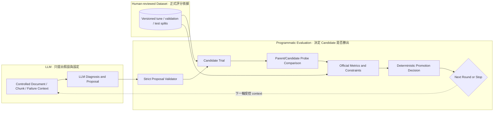

# v1.2 — LLM-guided Retrieval Optimization Agent · Design

> 狀態：**已實作完成**（tag `v1.2-llm-agent-mvp`，merge commit `aec93b7`）。
> 範圍：Emergency MVP。實際 runtime 驗收見 [v1.2-runtime-acceptance.md](v1.2-runtime-acceptance.md)；
> 程式位於 [`evaluation/v12/agent/`](../evaluation/v12/agent/)。
> 語言：繁體中文。

## 1. 定位

v1.2 是一個**有界（bounded）的 LLM-guided 檢索最佳化 Agent**。核心命題只有一句：

> **LLM 只提出假設與設定；是否勝出一律由固定資料集、Metrics、Constraints 與
> deterministic gate 判定。LLM 不參與自己提案的勝負判定。**

它建立在 v1.1 之上，而非取代 v1.1：

| 層 | 角色 | 來源 |
| --- | --- | --- |
| **LLM** | 閱讀受控的文件片段、Chunk 與失敗實況，提出診斷、Probe Questions 與下一輪 Chunking／Retrieval 設定 | `llm_planner.py` / `planner.py`（Fake） |
| **Programmatic Evaluation** | Strict Validator → Candidate Trial → Parent／Candidate Probe 比較 → Metrics／Constraints → deterministic promotion gate | `validator.py` / `executor.py` / `probes.py` / `orchestrator.py` |
| **Human-reviewed Dataset** | tune／validation／test 分割，皆來自 v1.1 人工審核過的評估資料集，是**唯一**的正式評分依據 | v1.1（見 [requirements](v1.1-retrieval-optimizer-requirements.md)） |

LLM 在迴圈中只看得到 **tune 逐題資料**與 **validation 的 coarse gate**（`pass` / `fail` /
`not_evaluated`）；validation 的實際數值與 held-out test 對 LLM 隱藏。

**不宣稱能取代領域人工專家**：出題品質、證據正確性與正式評分基準，仍以 v1.1 人工審核過的資料集為準。

---

## 2. Agent Loop



### 2.1 單輪流程

```text
Parent（第 0 輪為 baseline，真實建立並在 tune／validation 上實算指標）
  → 組裝受控 Context（tune failures + segments + 上一輪 probe comparison + coarse gate）
  → Planner 產生 Proposal（fake 或 llm）
  → Parser 嚴格 JSON 解析（fail-closed）
  → Validator 政策驗證
      ├─ 不合法 → 記 rejected，不執行 Trial，進下一輪或停止
      └─ 合法 → Candidate Trial（隔離 collection）
                → Probe：同一組 probe 在 Parent 與 Candidate 上分別執行並比較
                → Official Metrics + Hard Constraints
                → Deterministic Promotion Decision
                     ├─ promoted → Candidate 成為下一輪 Parent，清理舊 Parent collection
                     └─ rejected → 保留原 Parent，清理 Candidate collection
```

### 2.2 States 與 Stop Reasons

狀態（`orchestrator.AgentState`）：

```text
created → baseline_running → analyzing → proposal_validating → trial_running
        → probe_running → evaluating → promotion_deciding → awaiting_next_round
        → completed | stopped | failed
```

停止原因（`orchestrator.StopReason`）：

| Stop reason | 觸發條件 |
| --- | --- |
| `max_rounds` | 達到 `budget.max_rounds` |
| `max_llm_calls` | 達到 `budget.max_llm_calls` |
| `no_improvement_rounds` | 連續無改善輪數達上限 |
| `duplicate_proposal` | 提案 config hash 與已測試過的重複 |
| `no_valid_proposal` | 無法產生合法 Proposal |
| `max_consecutive_rejections` | 連續被拒次數達 `budget.max_consecutive_rejections` |
| `target_metric_reached` | 達成目標指標 |
| `llm_recommended_stop` | LLM 提出 `stop_recommendation`（**只是建議**，實際由 Orchestrator 依 budget 決定） |
| `manual_stop` / `fatal_trial_failure` / `llm_error` / `baseline_failed` | 中止類 |

只有 `max_rounds` / `target_metric_reached` / `llm_recommended_stop` 視為 `completed`，其餘為 `stopped` / `failed`。

---

## 3. Controlled Context（LLM 看得到什麼）

Context Builder（`context.py`）組裝的內容受 `budget.context_char_budget`（預設 12000 字元）限制：

**提供給 LLM**

- tune split 的**逐題失敗實況**（`tune_failures`：case_id、query、實際檢索結果與 rank）
- 受控的文件 **Segment 節錄**（`available_segment_ids` 明確列出可綁定的 segment id）
- Parent 的 **coarse tune metrics**
- 上一輪的 **Parent／Candidate Probe Comparison**（回饋確實進入下一輪；context hash 因此逐輪不同）
- **`editable_current_config`**：把 `current_config` 過濾為**僅含 Validator 白名單欄位**的現值，
  供 LLM 逐欄位照抄
- **hard constraints 頂層物件**：`max_parameter_changes`、`max_probe_questions`、`available_segment_ids`

**不提供給 LLM**

- validation 的實際數值（只給 coarse gate `pass` / `fail` / `not_evaluated`）
- held-out test split（Emergency MVP 完全不進入迴圈）
- 整份 corpus 全文
- 任何 secret 或 provider 設定

> **設計教訓**：初版把 `max_parameter_changes` 只藏在 context 的 budget 物件內、`current_config`
> 含不可提案的 canonical 版本欄位、`output_schema` 範例誘導 LLM 臆造 anchor —— 導致能力足夠的
> Provider 也產不出合法 Proposal。修正只動受控 context／LLM 指令，**Validator 與安全政策完全未放寬**。
> 根因與修法逐項見 [v1.2-runtime-acceptance.md §Runtime Bug Found / §Fix Applied](v1.2-runtime-acceptance.md#runtime-bug-found)。

---

## 4. Proposal Schema

由 `proposal.py` 定義資料型別與**受控詞彙**；解析在 `parser.py`，政策驗證在 `validator.py`。

```jsonc
{
  "diagnoses": [
    {
      "case_id": "...",
      "failure_type": "miss",            // 受控詞彙，見下表
      "reason": "...",
      "supporting_observations": ["..."]
    }
  ],
  "proposed_config": {
    "chunk_config":     { /* 只能是白名單欄位，見 §5 */ },
    "retrieval_config": { /* 只能是白名單欄位，見 §5 */ }
  },
  "probe_questions": [
    {
      "question": "...",
      "query_type": "...",
      "source_segment_ids": ["seg-..."],      // 必填，須存在
      "anchor_text_suggestions": [],          // 若填，須是所綁定 segment 的逐字子字串
      "rationale": "..."
    }
  ],
  "expected_effects": [
    { "metric": "...", "direction": "increase|decrease", "rationale": "..." }
  ],
  "confidence": 0.0,
  "stop_recommendation": false
}
```

**受控詞彙**

| 欄位 | 允許值 |
| --- | --- |
| `diagnoses[].failure_type` | `miss`、`wrong_rank`、`unanswerable_false_positive`、`confusable_confusion`、`threshold_too_high`、`chunk_boundary`、`identifier_ambiguity` |
| `expected_effects[].direction` | `increase`、`decrease` |

**語意邊界**

- `probe_questions` 只是**診斷探針**：不進正式 Dataset、不決定 Recommendation Eligibility、不自動發布。
- `expected_effects` 僅供 Audit 與下一輪對照，**不影響升級判定**。
- `stop_recommendation` 只是建議；是否真的停止由 Orchestrator 依 Budget 決定。

### 4.1 Parser（`parser.py`）

嚴格 JSON 解析，**fail-closed**：任一欄位不合法即**整個回應失敗**，不接受半完成提案，
不做欄位補值或猜測。Parser 獨立於 LLM，不信任 LLM 的任何自述。

---

## 5. Validator（`validator.py`）

獨立於 LLM 的政策閘門。結構驗證與 canonical 化一律**委派給既有 v1.1** 的 `ChunkingConfig` /
`RetrievalConfig` / `TrialConfig`（它們已拒絕未知欄位、強制範圍、檢查 strategy 欄位適用性、
dense 策略拒絕 identifier 欄位）。Validator **不執行任何 config**，只回傳 `ValidationResult`。

Validator 在 v1.1 之上額外強制的 agent 級政策：

| # | 檢查 | 失敗訊息意義 |
| --- | --- | --- |
| 1 | `proposed_config` 欄位落在 `allowed_parameter_space` 白名單（**比 v1.1 更窄**，例如禁止 `schema_version`） | 白名單外欄位，LLM 不得設定 |
| 2 | `strategy` 在允許集合內 | chunk：`current` / `paragraph` / `heading`；retrieval：`dense` / `identifier_aware` |
| 3 | 數值落在 agent 界限內（比 v1.1 結構性驗證更緊） | 見 §5.2 界限表 |
| 4 | 參數變更數 ≤ `budget.max_parameter_changes` | strategy 切換記為 1 個變更；identifier-only 欄位只在雙方都是 `identifier_aware` 時逐一比較 |
| 5 | 不得與 Parent 完全相同 | config hash 相同即拒絕 |
| 6 | 不得與已測試 config 重複 | 對照 `tested_config_hashes` |
| 7 | probe 數 ≤ `budget.max_probe_questions`；每個 probe 綁定既有 Segment，且 anchor 文字**真的出現在該 Segment**內 | **不得臆造 anchor** |

### 5.1 白名單欄位

```text
chunk_config    : strategy, target_chars, overlap_chars, max_tokens,
                  context_before_paragraphs, context_after_paragraphs,
                  prepend_section_title
retrieval_config: strategy, top_k, score_threshold, candidate_multiplier, candidate_cap,
                  identifier_candidate_cap, exact_match_boost, confusable_penalty,
                  identifier_vector_floor
```

### 5.2 預設 agent 界限

| 欄位 | 界限 | | 欄位 | 界限 |
| --- | --- | --- | --- | --- |
| `target_chars` | 200 – 1200 | | `top_k` | 1 – 10 |
| `overlap_chars` | 0 – 400 | | `score_threshold` | 0.0 – 1.0 |
| `max_tokens` | 128 – 1024 | | `candidate_multiplier` | 1 – 10 |
| `context_before_paragraphs` | 0 – 3 | | `candidate_cap` | 1 – 200 |
| `context_after_paragraphs` | 0 – 3 | | `identifier_candidate_cap` | 1 – 100 |
| | | | `exact_match_boost` | 0.0 – 1.0 |
| | | | `confusable_penalty` | 0.0 – 1.0 |
| | | | `identifier_vector_floor` | 0.0 – 1.0 |

界限與允許 strategy 皆可由 run config 的 `allowed_parameter_space` 覆寫，但只能**更窄**地收斂
LLM 的搜尋空間；v1.1 的結構性驗證永遠是外層底線。

### 5.3 Budget 預設值

| 欄位 | 預設 | 作用 |
| --- | ---: | --- |
| `max_rounds` | 2 | 迴圈輪數硬上限 |
| `max_llm_calls` | 4 | Provider 呼叫次數硬上限 |
| `max_probe_questions` | 3 | 每輪 probe 數上限 |
| `max_parameter_changes` | 2 | 單次提案可改動的參數數上限 |
| `no_improvement_rounds` | 1 | 連續無改善輪數上限 |
| `max_consecutive_rejections` | 2 | 連續被拒次數上限 |
| `context_char_budget` | 12000 | 送進 LLM 的 context 字元預算 |

---

## 6. Promotion Semantics（**LLM 不參與**）

`orchestrator._decide_promotion` 是兩段式判定，兩段都重用 v1.1 的既有元件：

### 第一段 — Validation Hard Constraints

以 v1.1 `HardConstraint` 對 Candidate 的 **validation** 指標做評估，同時涵蓋：

- **absolute gate**：絕對門檻（例如 unanswerable false-positive rate 上限）
- **non-regression**：相對於 Parent 的退化容忍

不 feasible → `rejected`，reason 為 `validation_gate_failed: <逐項原因>`，gate 標為 `fail`。

### 第二段 — Deterministic Comparator

重用 v1.1 的 **recommendation ordering** 逐鍵比較 Candidate 與 Parent。關鍵規則：

> **只有在「決勝鍵不是 `config_hash`」時，Candidate 才算勝出。**

`config_hash` 是 comparator 最後一個**穩定排序 tiebreak**，用來讓排序結果可重現，
**不是品質指標**。若所有實質品質指標打平、只能靠 `config_hash` 分出順序，判定為**不勝出**。

因此 CLI／Audit 中出現的原始字串：

```text
not_better_than_parent (decided_by=config_hash)
```

其正確解讀是：

```text
quality_metrics_tied
stable_order_tiebreak=config_hash
candidate_not_promoted
```

**Candidate rejection is a valid result.** The LLM proposes experiments; it does not decide
whether its own proposal wins.

### Recommendation Eligibility

Emergency MVP 全程維持 `not_evaluated` —— held-out test 與 recommendation lock **不在本版範圍**。
候選被拒或被升級都不會改變這一點，也不會觸發任何 Apply。

---

## 7. Safety Boundaries

| # | 邊界 | 落實位置 |
| --- | --- | --- |
| 1 | **Bounded rounds 與 LLM calls** — 由 run config `budget` 硬性上限 | `run_config.AgentBudget` |
| 2 | **Strict JSON Proposal Schema**，parser／validator **獨立於 LLM** | `parser.py` / `validator.py` |
| 3 | **Whitelist-only Config** — 只能提出白名單內的 chunking／retrieval 欄位與界限 | `validator._check_whitelist` / `_check_bounds` |
| 4 | **Human-reviewed official dataset** — 正式評分依據為人工審核過的資料集 | v1.1 dataset |
| 5 | **Validation 對 LLM 隱藏**，只提供 coarse gate（`pass`／`fail`／`not_evaluated`） | `orchestrator._coarse` |
| 6 | **Held-out test split 不進入 Emergency MVP 迴圈** | 範圍限制 |
| 7 | **不自動 Apply** | 無 apply 路徑 |
| 8 | **不自動 Publish Dataset** | probe 不進正式 dataset |
| 9 | **受保護的正式 collection** — `factory_knowledge` **永不被觸碰** | `executor.cleanup` 經 `is_optimizer_collection` 守門 |
| 10 | **安全的 collection 清理** — 只刪 `optimizer_` 前綴 | 同上 |
| 11 | **匿名化 Audit** — 不保存 secret、完整 prompt 或文件全文 | `repository.py` |

補充：

- 真實 Provider **不會**因環境存在金鑰就自動呼叫；一律需明確 `--planner llm`。
- Fake Planner 完全不呼叫任何 Provider，可在無 API key 環境跑完整迴圈。
- Trial 失敗只清理 Candidate collection、保留 Parent，不影響正式索引。

---

## 8. Audit

Agent DB 寫入**匿名化**紀錄：round、state、proposal、probe comparison、tune delta、
coarse gate、rejection reason、promotion decision 與 reason。

**不保存**：API key、`Authorization` header、raw response、完整 system prompt、文件全文、私人路徑。

`token_usage` 可能為 `null` —— 共用的正式 LLM client 只回傳文字。

檢視方式見 [developer-guide.md](developer-guide.md#v12-agent-cli)。

---

## 9. 已知限制

v1.2 的已知限制以 [v1.2-runtime-acceptance.md §Known Limitations](v1.2-runtime-acceptance.md#known-limitations)
為 canonical source，重點：

- Demo baseline 在示範資料上 Accuracy／MRR 已是 1.0，本迴圈證明的是**迴圈與拒絕行為正確**，
  而非可量測的品質改善。
- 只能提出既有 whitelist 內的 chunking／retrieval 參數。
- Recommendation Eligibility 維持 `not_evaluated`。
- 目前只有最小 Audit；完整 resume 與報表 UI 為 deferred。
- 單一真實 provider／model 的一次執行，不足以證明跨模型的穩健性。

## 10. 相關文件

- [v1.2-runtime-acceptance.md](v1.2-runtime-acceptance.md) — 實際 runtime 驗收、Safety Audit
- [v1.1-retrieval-optimizer-requirements.md](v1.1-retrieval-optimizer-requirements.md) — metrics 定義、資料集 schema、Safety Rules
- [v1.1-retrieval-optimizer-architecture.md](v1.1-retrieval-optimizer-architecture.md) — Trial isolation、Apply／Rollback、設計取捨
- [developer-guide.md](developer-guide.md) — CLI 操作與環境設定
- [testing.md](testing.md) — 測試範圍與執行方式
